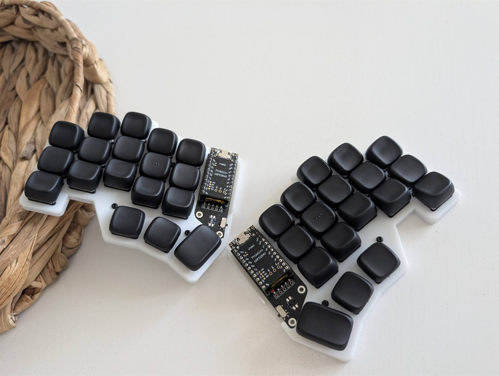
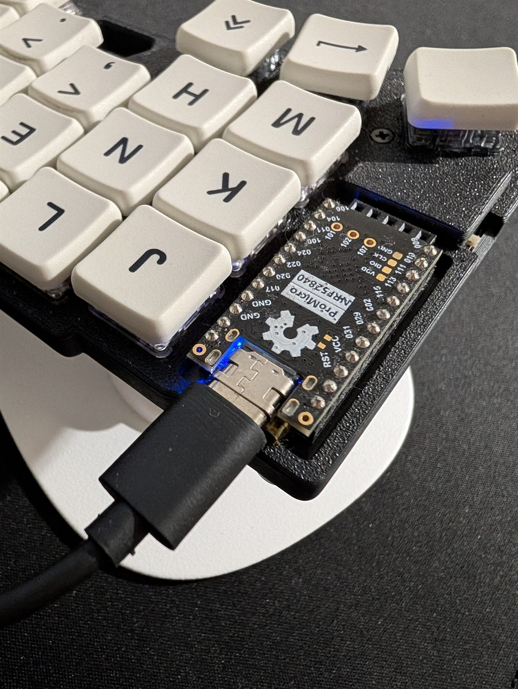
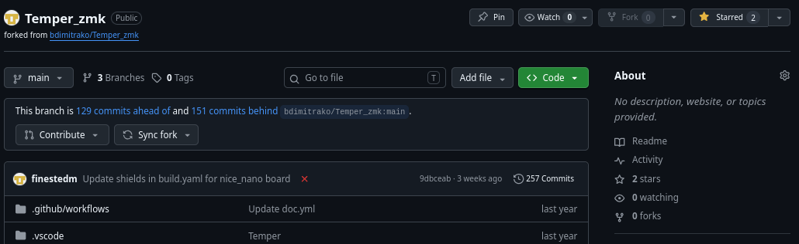
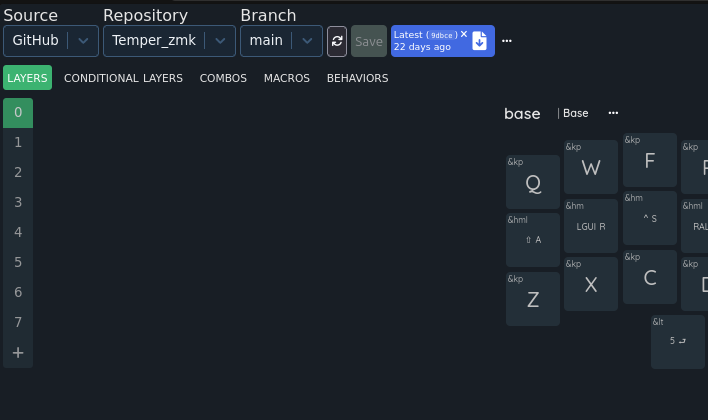
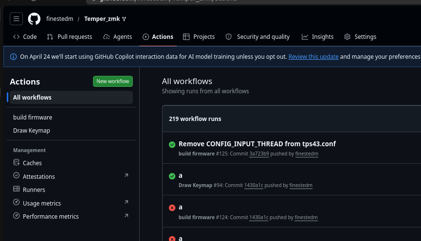
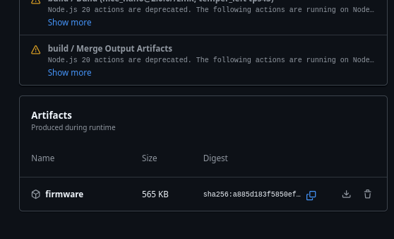
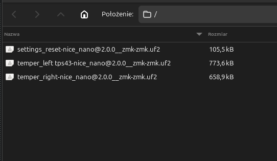
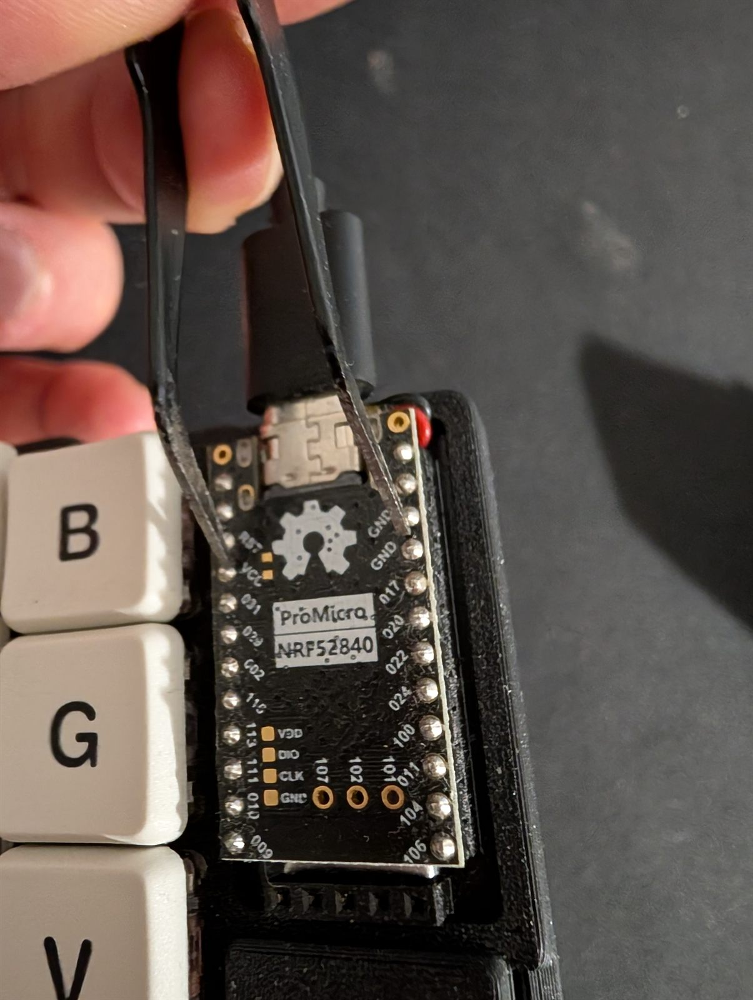
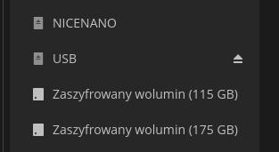

# FunkeeB Temper - user guide

Start with [ZMK Studio](https://zmk.studio/). It is the easiest way to make
basic keymap changes without creating a GitHub fork, compiling firmware or
flashing the keyboard again.

Use [Nick Coutsos' ZMK Keymap Editor](https://nickcoutsos.github.io/keymap-editor/)
and the GitHub build workflow when ZMK Studio cannot provide the functionality
you need. Examples include changing tap/hold timing such as `tapping-term-ms`,
editing custom hold-tap behaviors, or making repository-level changes to
combos, macros and firmware configuration.

This guide is adapted from the [FunkeeB user guide](https://funkeeb.vercel.app/?guide=user)
and updated for the `finestedm/temper-zmkstudio` repository.

## Recommended: basic editing with ZMK Studio

ZMK Studio edits the runtime keymap stored on the keyboard. It is the
recommended option for changing ordinary key assignments and arranging keys on
the existing layers.

### 1. Connect the left half

Connect the **left/central half** to the computer with a USB-C cable. ZMK Studio
support is enabled on the left firmware; the right half is a peripheral and
cannot be used as the Studio USB device.

### 2. Unlock ZMK Studio

Hold the thumb key that types `Esc` to activate the **Nav** layer, then press
`T` - the innermost top-row key on the left half, closest to the split. This
invokes the firmware's `studio_unlock` binding.

Open [ZMK Studio](https://zmk.studio/) immediately afterwards, select the
keyboard and make the required changes.

### 3. Understand what Studio changes

Studio changes are stored in the keyboard's settings memory. They do not edit
`config/temper.keymap` in the GitHub repository and therefore do not become
part of a newly compiled stock firmware.

If you later flash a keymap created with Nick Coutsos' editor, choose
**Restore Stock Settings** in ZMK Studio so that old runtime changes do not
continue to override the newly flashed keymap.

### When to use the advanced method

Use the fork/build/flash workflow below when you need to:

- change tap/hold timing, for example `tapping-term-ms`;
- change hold-tap flavor, quick-tap settings or trigger positions;
- add or modify combos, macros and custom behaviors;
- change settings not exposed by ZMK Studio;
- keep the complete configuration versioned and reproducible in GitHub.

## Layer shortcuts

Most layers are momentary: hold the listed key to use the layer and release it
to return to the previous layer. A quick tap still sends the key shown in the
second column.

| Layer | Hold this key | Typical purpose |
| --- | --- | --- |
| Base | - | Default QWERTY layer |
| Button | `Z` or `/` | Mouse buttons and editing actions |
| Nav | `Esc` thumb key | Navigation, Studio unlock and left bootloader |
| Mouse | `Space` thumb key | Keypad directions and mouse buttons |
| Media | `Tab` thumb key | Media, Bluetooth, output and display controls |
| Num | `Backspace` thumb key | Numbers and right bootloader |
| Sym | `Enter` thumb key | Symbols |
| Fun | `Delete` thumb key | Function keys |

The **Extra** and **Tap** layouts use guarded double-taps. Both presses must be
made within 200 ms:

- while Nav, Mouse or Media is active: double-tap `W` -> Tap, `E` -> Extra,
  `R` -> Base;
- while Num, Sym or Fun is active: double-tap `U` -> Base, `I` -> Extra,
  `O` -> Tap.

There are also paired persistent layer selectors:

- Nav: double-tap `C` -> Num, `V` -> Nav;
- Mouse: double-tap `C` -> Sym, `V` -> Mouse;
- Media: double-tap `C` -> Fun, `V` -> Media;
- Num: double-tap `M` -> Num, `,` -> Nav;
- Sym: double-tap `M` -> Sym, `,` -> Mouse;
- Fun: double-tap `M` -> Fun, `,` -> Media.

The current Tap layer contains only plain key presses and no layer-return
binding. If it is selected persistently, restart the keyboard to return to the
default Base layer. This is an existing limitation of the stock keymap.

## Advanced alternative: Nick Coutsos editor and custom firmware

This method saves the configuration in GitHub and produces new UF2 firmware
files. It takes more steps, but exposes settings that ZMK Studio does not edit.

### 1. Fork the repository

Fork [finestedm/temper-zmkstudio](https://github.com/finestedm/temper-zmkstudio)
to your own GitHub account. Work in your fork so your changes remain separate
from the upstream repository.

Use the default [`main`](https://github.com/finestedm/temper-zmkstudio/tree/main)
branch for the supported keymap, displays, Bongo Cat animation, ZMK Studio and
Nick Coutsos editor integration.

### 2. Edit the keymap and behaviors

Open [Nick Coutsos' ZMK Keymap Editor](https://nickcoutsos.github.io/keymap-editor/),
sign in with GitHub and select `config/temper.keymap` from your fork.

Use the editor for bindings, layers, combos and supported behaviors. For a
setting that is not exposed in the interface, edit `config/temper.keymap`
directly in GitHub. For example, the main hold-tap timing is controlled by
`tapping-term-ms` in the `u_mt` and `u_lt` behavior definitions.

The editor geometry is stored in `config/info.json`.

### 3. Build the firmware

Saving and pushing a change starts the repository's **Build ZMK firmware**
GitHub Action. Open the **Actions** tab in your fork and wait for the newest
workflow run to finish. A normal build takes a few minutes.

### 4. Download the firmware artifact

Open the completed workflow run and download its **firmware** artifact.

The archive contains:

- `temper-left-niceview-bongo.uf2` - left/central firmware;
- `temper-right-niceview-status.uf2` - right/peripheral firmware;
- `settings-reset.uf2` - temporary settings-reset firmware.

Do not leave `settings-reset.uf2` installed as the normal firmware. It is used
only to clear Bluetooth bonds, ZMK Studio runtime changes and other stored
settings.

### 5. Reset stored settings when necessary

When moving between substantially different layouts, flash
`settings-reset.uf2` to each half first. Enter the bootloader again and then
flash the correct normal firmware to that half.

This erases Bluetooth bonds and runtime keymap settings. Pair the keyboard with
the computer again after completing the process.

### 6. Enter the bootloader

The normal firmware provides keyboard shortcuts for both halves:

- **left half:** hold the thumb key that types `Esc` to activate **Nav**, then
  press `Q`;
- **right half:** hold the thumb key that types `Backspace` to activate
  **Num**, then press `P`.

The bootloader action is source-specific, so it resets the half on which `Q` or
`P` is physically pressed. The right half must be paired and connected to the
left half for its shortcut to be processed.

If the keyboard shortcut is unavailable, switch off or disconnect the battery
and briefly short the controller's `GND` and `RST` pins twice in quick
succession with a conductive object. The red LED should flash and the computer
should show a `NICENANO` drive.

### 7. Flash the correct UF2

Connect the half being flashed over USB and drag the correct file onto the
`NICENANO` drive:

- left half -> `temper-left-niceview-bongo.uf2`;
- right half -> `temper-right-niceview-status.uf2`.

The drive normally disappears and the controller reboots automatically. Wait
for the copy to finish before disconnecting USB. Do not swap the left and right
files; the split roles and key behavior will be wrong.

After flashing, disconnect USB, reconnect the battery if needed and power the
keyboard on again.

## Display notes

The current firmware is configured for Sharp LS011B7DH03/nice!view-compatible
160 x 68 SPI displays. The left display shows Bongo Cat, indicators and WPM;
the right display shows the status screen and FunKeeB branding. Generic I2C OLED
modules are not drop-in replacements without hardware and firmware changes.
